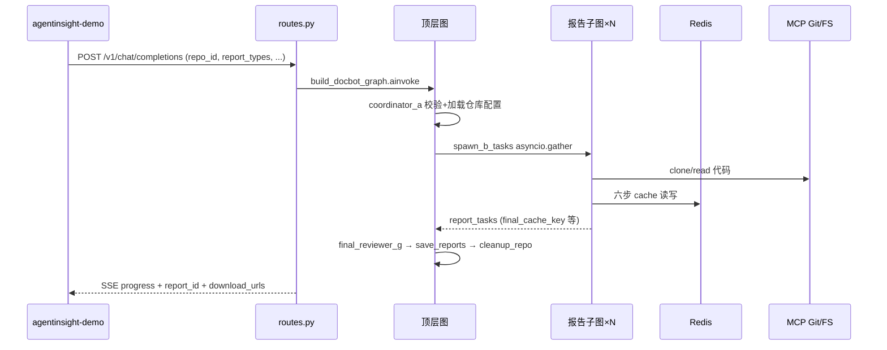
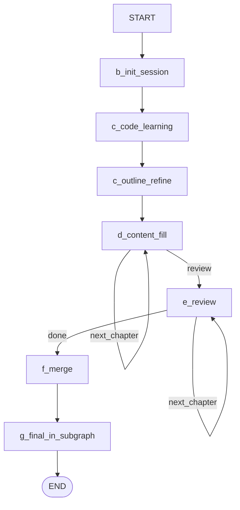
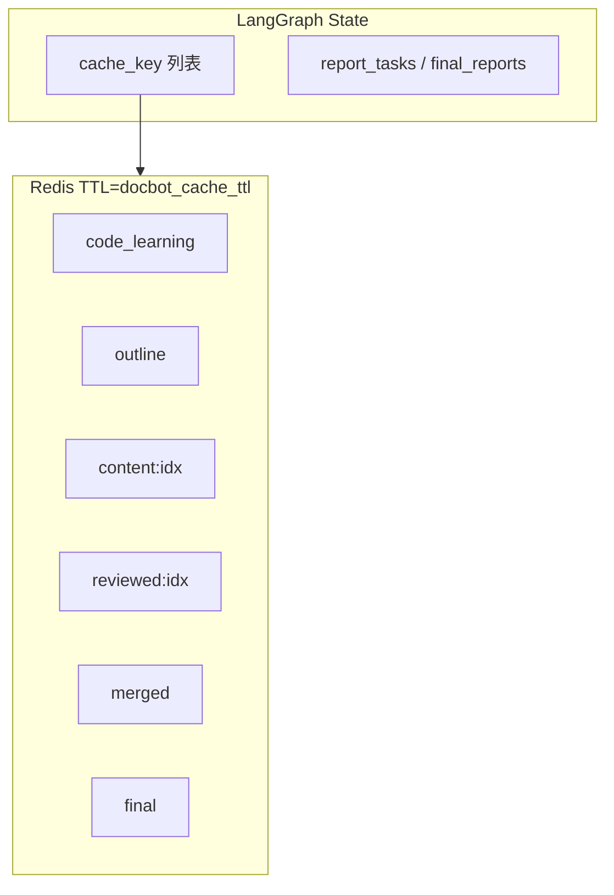
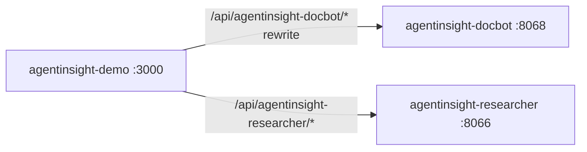
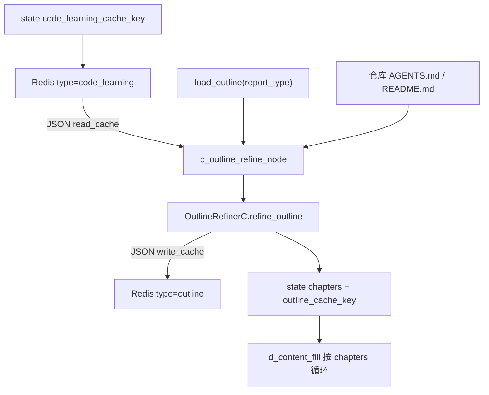
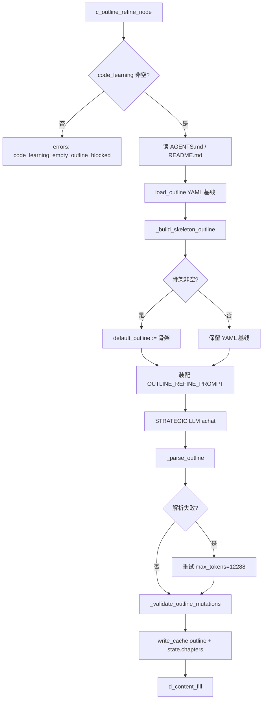
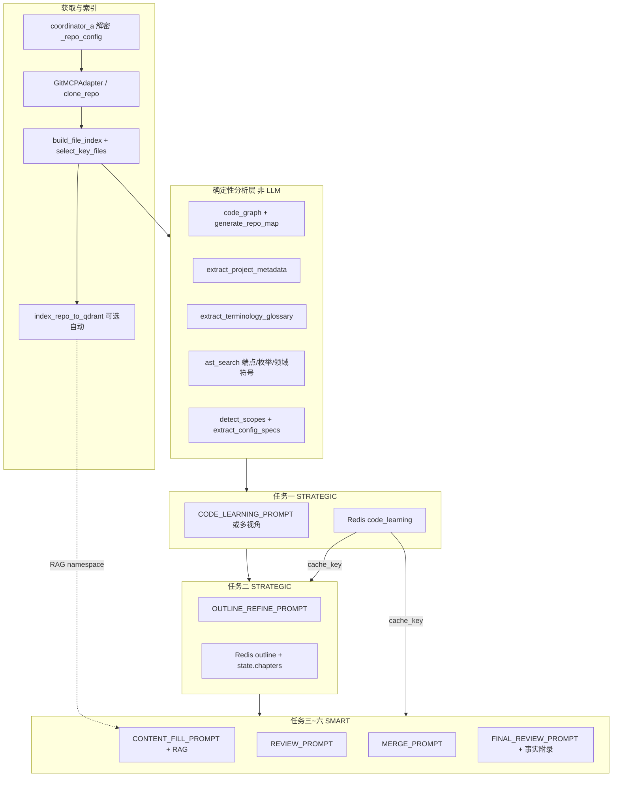
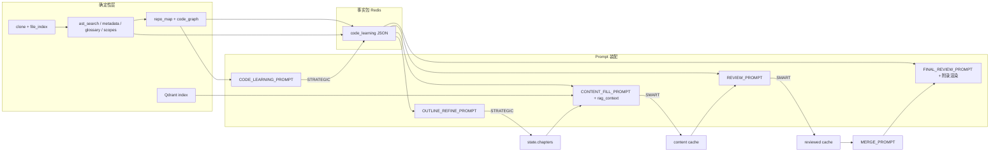

# agentinsight-docbot 技术架构文档

| 元信息 | 值 |
|--------|-----|
| **版本** | v2.1 |
| **日期** | 2026-07-31 |
| **端口** | 8068 |
| **`agent_id`** | `agentinsight-docbot` |
| **Compose 项目名** | `agentinsight-docbot`（与同机 researcher 8066 并存） |
| **真源规则** | 根目录 [`AGENTS.md`](../../AGENTS.md)、本目录 [`AGENTS.md`](../AGENTS.md) |
| **架构 SSOT** | 本文档 `docs/ARCHITECTURE.md`（Windows 下与 `architecture.md` 同路径；仓库内仅此一份顶层架构文档，勿另建分叉副本） |
| **代码级设计** | [`DESIGN_AGENT.md`](./DESIGN_AGENT.md)（节点签名 / 测试骨架；与本文冲突时以**最新代码**为准，并回写本文） |

## 专家审阅角色（≥10）

| 角色 | 职责 / 审阅范围 |
|------|----------------|
| 首席架构师 | 6 步流水线、7 子智能体（A–G）、顶层图 + 报告子图、独立部署边界 |
| LangGraph 编排专家 | `DocbotState` / `ReportTaskState`、`builder.py` / `report_builder.py`、D–E 循环 |
| RAG/检索工程师 | 代码分块索引、`repo_id` namespace、混合检索 |
| LLM 网关工程师 | FAST/SMART/STRATEGIC 三级模型与降级链 |
| FastAPI/API 专家 | `routes.py`、`repo_routes.py`、SSE progress 字段 |
| PostgreSQL/数据隔离专家 | `user_git_repos`、报告表、`agent_id` 固定 docbot |
| Qdrant/向量库专家 | 仓库向量隔离策略 |
| Redis/缓存专家 | `skills/docbot/cache.py` 六类中间产物键 |
| 可观测性（AgentInsight SDK）专家 | 节点与 `trace_chain`（缓存读写） |
| MCP/工具集成专家 | lifespan 启动 `mcp-server-git` / `filesystem`；`tools/git_mcp.py` |
| 安全合规工程师 | `GIT_CREDENTIAL_KEY` AES-GCM、仓库 URL 白名单 |
| Docker/部署工程师 | 5 容器编排、无 SearXNG |
| 测试/CI 工程师 | `tests/` 与 docbot 专属 e2e |
| 文档工程师 | 本文为顶层架构 SSOT（`docs/ARCHITECTURE.md`）；[`DESIGN_AGENT.md`](./DESIGN_AGENT.md) 为代码级设计；第 15–16 章覆盖纲要 LLM 优化与代码→LLM 输入装配 |

---

## 1. 项目定位与能力边界

**定位**：根据用户**代码仓库**一键生成技术文档的多智能体系统，对外 **OpenAI 兼容 API**（SSE 流式，端口 **8068**）。

**流水线**：LangGraph 编排 **7 个逻辑子智能体（A–G）**，完成 **6 步**（代码学习 → 纲要细化 → 内容填充 → 评审 → 合并 → 终审），支持 **8 种文档类型** × **5 种格式** × **2 种语言**。

**能力边界**：

| 支持 | 不支持 |
|------|--------|
| GitHub/GitLab/Gitee 等个人仓库 HTTPS/SSH/Token | 模型训练、前端 SSR |
| 多报告类型 `asyncio.gather` 并发 | `/v1/feedback`、`/v1/ws`、`/v1/mcp/configs`（刻意不暴露） |
| 流式 SSE 进度 + 报告下载 | 与 AIR 代码双向同步（拷贝后独立演进） |

**前端**：全部在 [`agentinsight-demo`](../../agentinsight-demo)（仓库配置、一键生成、进度条、下载）。

**代码复用**：自 `agentinsight-researcher` 拷贝的 `common/`、`rag/`、`llm/`、`memory/`、`observability/` 及部分 `api/`、`skills/researcher/publisher.py` 等在本仓库**独立维护**。

---

## 2. 技术栈与依赖

与根 `AGENTS.md` 一致，**本子项目特征**：

| 项 | 说明 |
|----|------|
| 三级 LLM | `FAST_LLM` / `SMART_LLM` / `STRATEGIC_LLM`（见 `.env.template`） |
| MCP | 系统自带 git + filesystem，**不入** `mcp_configs` 表 |
| 并发派发 | `asyncio.gather` + `Semaphore`（非 LangGraph Send API） |
| 中间产物 | Redis 存内容，State 仅存 `cache_key` |
| PostgreSQL | ≥17，5 容器内含本地 postgres |
| 无 SearXNG | 检索面向仓库 RAG，非 Web 元搜索 |

---

## 3. 目录结构与模块边界

```
agentinsight-docbot/
├── server.py                      # lifespan：MCP 子进程、init_database、Qdrant 预热
├── src/
│   ├── graph/
│   │   ├── state.py               # DocbotState + ReportTaskState
│   │   ├── builder.py             # 顶层图
│   │   ├── report_builder.py      # 报告子图（含 c_outline_refine）
│   │   ├── nodes.py / report_nodes.py / edges.py
│   ├── agents/docbot/             # A–G：coordinator / outline_refiner / content_filler / ...
│   ├── skills/docbot/             # 流水线技能
│   │   ├── repo_loader.py         # clone / file_index / 分块 / Qdrant 索引
│   │   ├── code_learner.py        # 任务一 learn_code（STRATEGIC）
│   │   ├── multi_perspective_learner.py  # 可选多视角审问
│   │   ├── repo_map.py / ast_search.py / code_graph 构建
│   │   ├── project_metadata.py / terminology_glossary.py / scope_detector.py
│   │   ├── citation_extractor.py
│   │   ├── outline_skill.py / content_skill.py / cache.py
│   ├── config/docbot/             # personas、outlines/*.yaml、prompts
│   ├── tools/git_mcp.py           # GitMCPAdapter（系统 MCP）
│   └── api/repo_routes.py         # /v1/repos CRUD
├── scripts/init.sql
└── docker-compose.yml
```

**临时目录**：克隆路径 `temp/repos/{user_id}/{repo_id}/`（`.gitignore`）。

---

## 4. 核心架构图

### 4.1 端到端请求流



### 4.2 顶层 LangGraph


`spawn_b_tasks` 内对每个 `report_type` 编译并执行 `build_report_subgraph()`，并发受 `Semaphore` 限制。

### 4.3 报告子图（单 report_type）



路由函数：`route_after_d` / `route_after_e`（`src/graph/edges.py`）；章节修订上限 `max_revisions_per_chapter`（默认 3）。

### 4.4 数据流（State 瘦、Redis 胖）



键格式（v12，含可选 `repo_id` 防同 session 换仓污染）：

```text
docbot:{agent_id}:{user_id}:{session_id}[:{repo_id}]:{type}:{report_type}[:{chapter_idx}]
```

`type ∈ {code_learning, outline, content, reviewed, merged, final}`；TTL 默认 `settings.docbot_cache_ttl=86400`（`skills/docbot/cache.py` 的 `build_cache_key` / `write_cache` / `read_cache`）。

---

## 5. LangGraph State 摘要

**DocbotState**（顶层）：

- `repo_id`、`report_types`、`report_format`、`language`
- `_repo_config`（解密后仓库凭据，敏感，不应长期依赖 Checkpoint 泄露面）
- `report_tasks` / `final_reports`（覆盖语义，非 `operator.add`）
- `errors: Annotated[list, operator.add]`

**ReportTaskState**（子图）：

- `chapters`、`current_chapter_idx`、`review_idx`
- `*_cache_key` 字段族；`content_cache_keys` / `reviewed_cache_keys` 累积
- 输出：`report_id`、`download_urls`、`report_image_svg`

**Checkpoint**：仅顶层图挂 `PostgresSaver`；子图不独立 checkpointer。`thread_id` 顶层 `{agent_id}:{session_id}`；子图配置可含 `{report_type}` 后缀（见 AGENTS.md）。

---

## 6. 子智能体与 6 步映射

| 代号 | 模块 | 步骤 | 典型 LLM tier |
|------|------|------|----------------|
| A | `coordinator.py` | 入口校验、加载 `_repo_config` | 校验为主 |
| B | `report_runner.py` | 子图调度语义 | — |
| C | `code_learner.py`（+ 可选 `multi_perspective_learner.py`）+ `OutlineRefinerC` / `outline_skill.py` | 任务一代码学习、任务二纲要优化 | **STRATEGIC** |
| D | `content_filler.py` / `content_skill.py` | 任务三内容填充（RAG + AST 事实注入） | **SMART** |
| E | `reviewer.py` | 任务四章节评审 | **SMART** |
| F | `merger.py` | 任务五合并去重 | **SMART** |
| G | `final_reviewer.py` | 任务六子图终审 + 顶层交叉终审 | **SMART** |

默认大纲：`src/config/docbot/outlines/*.yaml`，由 `outlines.py`（`OutlineSpec` Pydantic）加载，**仅作基线**，任务二必须由 STRATEGIC LLM 增删改（详见第 15 章）。persona：`DOCBOT_REPORT_PERSONAS`。

**硬约束（全流水线）**：

1. **纲要可增删章节**：默认 YAML 不是最终结构；`source=added|removed|refined|skeleton` 标记变更；`_validate_outline_mutations` 禁止原样输出基线。
2. **无特定产品/仓库硬编码**：品牌名、API 路径、错误码、FR 列表等事实须来自 AST / `project_metadata` / `scopes` / 仓库 AGENTS.md·README，禁止写死某一产品名。

并发与超时相关配置（`src/config/settings.py`）：`max_concurrent_reports=3`、`max_revisions_per_chapter=3`、`max_chapters_per_report=20`、`max_llm_concurrency=5`、`docbot_multi_perspective_enabled=False`（默认关）、`docbot_cache_ttl=86400`。

---

## 7. API 层

**挂载**（`server.py`）：`/v1` chat + sessions + repos；**无** feedback/ws/mcp CRUD。

| 端点 | 说明 |
|------|------|
| `POST /v1/chat/completions` | 携带 docbot 扩展字段（`repo_id`、`report_types` 等）；SSE `delta.progress` |
| `/v1/repos` | 仓库 CRUD、连接测试、同步（`repo_routes.py`） |
| `/v1/sessions` | 与会话元数据（拷贝自 AIR 并演进） |
| `GET /v1/reports/{id}/download` | 多格式下载 |
| `GET /health` | 健康检查 |

身份解析与 researcher 相同模式（JWT → IP 降级）。

---

## 8. 数据层

**PostgreSQL 专属/共享表**（`scripts/init.sql`）：

| 表 | 用途 |
|----|------|
| `user_git_repos` | 仓库 URL、加密凭据、分支、同步状态 |
| `research_reports` / `chat_messages` 等 | 共享 DDL，`agent_id='agentinsight-docbot'` 隔离 |
| `report_limits` / `daily_report_usage` | IP/用户报告配额 |

**Qdrant**：集合 `agents`；用户仓库索引 namespace 含 `repo_id`（见 `rag/` 实现与 AGENTS.md 第 7 章 docbot 偏差说明）。

**Redis**：除 docbot 流水线键外，通用键仍遵循 `{agent_id}:{user_id}:...` 前缀。

---

## 9. RAG / LLM / MCP

- **仓库加载**：`repo_loader.py` 克隆 → 分块 → 写入 Qdrant + BM25 语料（详见第 16.2 节）。
- **确定性事实层**：AST / repo_map / metadata / glossary / scopes（第 16.3 节）→ 注入任务一～六 prompt。
- **RAG 检索**：任务三按章节召回；`trace_retriever` 包裹；空结果降级 `repo_map` + `code_summary`。
- **LLM**：任务一/二 STRATEGIC（含纲要增删改，第 15 章），三四五六 SMART；`LLMClient` 三级降级链。
- **MCP**：`server.py` lifespan 启动 `uvx mcp-server-git` 与 `npx @modelcontextprotocol/server-filesystem`；`GitMCPAdapter` 提供高级 API。
- **导出**：`skills/researcher/publisher.py` 生成 MD/HTML/PDF/DOCX/JSON；可选 `image_generator.py` SVG。

---

## 10. 可观测性

- 编排入口：`trace_agent` 包裹顶层 `graph.ainvoke`（`routes.py`）。
- 缓存管道：`trace_chain` 包裹 `write_cache` / `read_cache`（`cache.py`）。
- LLM/RAG/工具：与 AIR 相同分层规则（generation 仅在 `llm/`）。

---

## 11. 部署

**5 容器**（`docker compose -p agentinsight-docbot -f docker-compose.yml up -d`）：

| 服务 | 端口 |
|------|------|
| `agent-docbot` | **8068** |
| `postgres` | 127.0.0.1:5432 |
| `redis` | 127.0.0.1:6379 |
| `qdrant` | 127.0.0.1:6333 |
| `embeddings` | 8088 |

依赖顺序：`postgres` → `redis` → `qdrant` → `embeddings` → `agent-docbot`（`service_healthy`）。

**三套构建模式**：QA/离线编排与脚本在仓库根目录；本子目录保留生产联网 `Dockerfile` + `docker-compose.yml`。

---

## 12. 与演示平台 / researcher 集成



- Demo 通过 `lib/agents.config.ts` 声明 docbot `features.repoConfig` / `reportGeneration`。
- 两智能体**不** RPC 互调；用户在同一 UI 切换 Agent。

---

## 13. 关键环境变量（占位符）

| 变量 | 说明 |
|------|------|
| `FAST_LLM` / `SMART_LLM` / `STRATEGIC_LLM` | 三级模型 |
| `GIT_CREDENTIAL_KEY` | 仓库凭据 AES-GCM（32 字节 base64） |
| `ALLOWED_GIT_DOMAINS` | 克隆 URL 白名单 |
| `MAX_REPO_SIZE_MB` / `DOCBOT_CACHE_TTL` | 仓库与 Redis TTL |
| `POSTGRES_*` / `REDIS_*` / `QDRANT_*` / `EMBEDDINGS_*` | 基础设施 |
| `SELF_HOST` / `IP_DAILY_REPORT_LIMIT` | 身份与配额 |
| `AGENTINSIGHT_*` | 追踪 |

详见 `.env.template`。

---

## 14. 配套文档

- 代码级设计：[`DESIGN_AGENT.md`](./DESIGN_AGENT.md)
- 前端交互（已迁移）：[`../agentinsight-demo/docs/architecture.md`](../../agentinsight-demo/docs/architecture.md)
- 8 种文档默认大纲：`src/config/docbot/outlines/*.yaml`（原独立 OUTLINE.md 已迁移）
- **本文第 15 章**：通过 LLM 优化纲要（STRATEGIC + 校验 + Redis）
- **本文第 16 章**：代码 → LLM 输入装配（clone / AST / RAG → content_fill / review / final）

---

## 15. 通过 LLM 优化纲要（设计详解）

> **硬约束**：`outlines/*.yaml` 仅为**参考基线**，不是最终结构。任务二必须基于代码学习结果对章节做**实质性增删改**；禁止把默认 YAML 原样当作最终纲要输出。

### 15.1 在报告子图中的位置

报告子图由 `build_report_subgraph()`（`src/graph/report_builder.py`）编译，节点顺序：

```text
b_init_session → c_code_learning → c_outline_refine → d_content_fill
    ↕ (route_after_d)
e_review → f_merge → g_final_in_subgraph → END
```

| 节点 | 文件 / 入口 | LLM | 写入 State / Redis |
|------|-------------|---------------------|
| `c_code_learning` | `report_nodes.c_code_learning_node` → `learn_code()` | STRATEGIC | `code_learning_cache_key` |
| **`c_outline_refine`** | `report_nodes.c_outline_refine_node` → `OutlineRefinerC.refine_outline()` | **STRATEGIC** | `outline_cache_key` + `chapters` + `current_chapter_idx=0` + `review_idx=0` |
| `d_content_fill` | 消费 `state.chapters`（已优化纲要） | SMART | `content_cache_keys[idx]` |

无代码学习结果时，`c_outline_refine_node` **拒绝**原样使用默认 YAML，返回 `errors: ["code_learning_empty_outline_blocked"]` 与空 `chapters`。

### 15.2 默认大纲基线（YAML）

- **加载器**：`src/config/docbot/outlines.py`
  - `load_outline(report_type) -> list[dict]`：章节列表（传给 `default_outline`）
  - `load_outline_meta(report_type)`：含 `max_chapters` 等
  - `OutlineSpec` / `OutlineChapter`：Pydantic 校验 YAML 结构
- **文件**：`src/config/docbot/outlines/{architecture|design|requirements|testcase|optimization|performance|defect|api_doc}.yaml`
- **典型字段**：`report_type` / `name_zh` / `name_en` / `default_chapters` / `max_chapters` / `persona` / `chapters[]{idx,title,purpose,sections,key_points,example}` / `writing_rules` / `output_format`
- **Persona**：`src/config/docbot/personas.py` 的 `DOCBOT_REPORT_PERSONAS`（`role_name` / `description` / `outline_yaml`）

YAML 中可含条件性章节说明（如「无 SDK 子项目则删除」），由 STRATEGIC + `scopes_text` 在运行时落实，而非在 Python 里写死某仓库名。

### 15.3 数据流与缓存



- **读**：`read_cache(code_learning_cache_key)` → `code_learning` dict（含 `summary` / `key_modules` / `http_endpoints` / `*_text` 等，见第 16 章）。
- **写**：`build_cache_key(..., type_="outline", report_type=..., repo_id=...)` → `write_cache(outline_cache_key, json.dumps(refined))`。
- **轻量封装**：`skills/docbot/outline_skill.refine_outline()` 直接委托 `OutlineRefinerC`（节点当前主要走 `OutlineRefinerC` 直连，并额外传入 `agents_md` / `readme_md` / `default_outline`）。

### 15.4 `OutlineRefinerC` 两阶段优化算法

实现：`src/agents/docbot/outline_refiner.py`。

**阶段 1 — 骨架大纲（非 LLM）**：`_build_skeleton_outline(code_learning, report_type, default_outline)`

- 输入事实：`http_endpoints` / `key_modules` / `dependencies`（均来自任务一 AST/扫描，**无产品硬编码**）。
- `api_doc`：按 `class_name`（Controller）分章，每章 `sections` 为真实 `METHOD route`；保留引言 / API 概览 / 认证 / 错误码章。
- `requirements`：按端点推导 FR 列表（`FR-001…`，上限与端点数对齐）；NFR / 接口 / 数据 / 约束 / 追踪矩阵骨架。
- 其他 `report_type`：无足够事实时返回 `[]`，回退到默认 YAML 作 LLM 起点。
- 若骨架非空，**用骨架替换** `default_outline` 再交给 LLM，减少「通用示例污染」（如虚构的 `/users`、OAuth2）。

**阶段 2 — STRATEGIC LLM 精炼**：模板 `OUTLINE_REFINE_PROMPT`（`src/config/docbot/prompts.py`）

`format()` 关键占位符：

| 占位符 | 来源 |
|--------|------|
| `role_name` / `description` | persona |
| `report_type` / `language` / `max_chapters` | state + outline meta |
| `default_outline` | YAML 或骨架 |
| `code_summary` / `key_modules` / `dependencies` | code_learning |
| `agents_md` / `readme_md` | `_read_repo_doc(repo_path, …)`（优先 AGENTS.md） |
| `project_metadata_text` / `glossary_text` / `endpoints_text` / `enums_text` / `config_specs_text` / `scopes_text` | code_learning v8 字段 |

额外追加（按类型）：`PRD_STRUCTURE_GUIDE`（`requirements`）或 `API_DOC_STRUCTURE_GUIDE`（`api_doc`）——仅通用结构原则，**禁止**套用预设业务域。

LLM 调用：`LLMClient.achat(..., tier=LLMTier.STRATEGIC, max_tokens=8192)`；解析失败可重试 `max_tokens=12288`（`_parse_outline`）。

**期望输出 JSON 章节字段**：`idx` / `title` / `sections` / `key_points` / `source`（`added|removed|refined|default|skeleton`）/ `refine_reason`；可选 `controller_name`（api_doc，供内容填充过滤）。

### 15.5 校验：`_validate_outline_mutations`

在 LLM 解析之后强制执行：

1. 统计各 `source` 计数写入 `_source_counts`。
2. 若 `mutations==0` 且标题集合与基线完全一致，且存在 `http_endpoints` → **强制骨架重建**（禁止「未优化」）。
3. `api_doc`：若缺失约 ≥1/3 Controller 对应章节 → 从骨架**追加**缺失章（`source=added`）。
4. 后续 `_dedupe_controller_chapters`：回填 `controller_name`、去重中英重复章。

Prompt 层已声明的增删规则（与校验互补）：

- **删**：无证据的 conditional 章；无 webhook 则删 Webhook 章；`scopes_text` 无独立 SDK 则删 SDK 章；`is_in_scope=false` 子项目不得入纲要。
- **增**：endpoints / key_modules 揭示但基线缺失的模块；按 Controller 分接口详情章；重要枚举需错误码章。
- **改（refined）**：用真实路径 / 实体 / 认证 / 错误码替换通用示例。

### 15.6 纲要优化流程图



### 15.7 与后续节点的契约

- `state.chapters` 是 D/E 唯一纲要真源（不再依赖默认 YAML）。
- `outline_cache_key` 存完整 `refined`（含 `refine_summary` / `_source_counts`），供调试与复用。
- 章节数上限：`max_chapters`（YAML meta，兜底 30）与 settings `max_chapters_per_report`（调度侧）共同约束。

---

## 16. 代码 → LLM 输入装配（设计详解）

> **硬约束**：系统不针对任何特定产品/仓库写死业务事实。所有品牌名、路由、枚举、配置项、术语均由 **AST / 文件扫描 / 元数据提取 / RAG** 在运行时从用户仓库产生，再格式化为 `*_text` 注入各任务 prompt。

### 16.1 端到端流水线总览



### 16.2 仓库获取与索引

| 步骤 | 模块 / 函数 | 说明 |
|------|-------------|------|
| 凭据 | `coordinator_a` + AES-GCM（`GIT_CREDENTIAL_KEY`） | `_repo_config` 注入子图；API 不回传明文 |
| 克隆 | `repo_loader.clone_repo` → `GitMCPAdapter.clone_repo` | 路径 `temp/repos/{user_id}/{repo_id}/`；已存在则 pull；`clone_depth` / `MAX_REPO_SIZE_MB` |
| 枚举 | `list_files` / `build_file_index` | 跳过 `.git` / `node_modules` / `__pycache__` / `dist` / `build` / `.venv` 等 |
| 关键文件 | `select_key_files` + `read_files` | 默认最多约 30 个入口/配置/核心文件供任务一阅读 |
| MCP API | `GitMCPAdapter`：`clone_repo` / `list_files` / `read_file` / `get_file_history` / `search_code` / `test_connection` | 系统 lifespan 启动 MCP 子进程，不入 `mcp_configs` |
| 向量索引 | `_ensure_qdrant_indexed` → `index_repo_to_qdrant` | namespace=`{agent_id}:{user_id}:{repo_id}`；失败不阻断（D 可降级用 file_index） |
| 分块 | `chunk_file` | 代码按函数/类；配置整体；文档按标题 |

### 16.3 确定性分析层（变成 `*_text`）

均在 `learn_code()`（`src/skills/docbot/code_learner.py`）中于 STRATEGIC 调用**之前**完成（失败降级为空，不阻断）：

| 层 | 模块 | 关键 API | 注入字段 |
|----|------|----------|----------|
| 依赖图 | code_graph（与 `repo_map` 配合） | `build_code_graph` / `format_code_graph_for_prompt` | `code_graph` dict |
| 符号地图 | `repo_map.py` | `generate_repo_map(..., code_graph=)` PageRank 排序 | `repo_map: str` |
| 项目元数据 | `project_metadata.py` | `extract_project_metadata` / `format_metadata_for_prompt` | `project_metadata` / `project_metadata_text` |
| 术语词典 | `terminology_glossary.py` | `extract_terminology_glossary` / `format_glossary_for_prompt` | `terminology_glossary` / `glossary_text` |
| HTTP/枚举/字面量路由 | `ast_search.py` | `search_http_endpoints` / `search_enum_definitions` / `search_domain_symbols` / `search_literal_api_routes` + `format_*_for_prompt` | `http_endpoints` / `enum_definitions` / `endpoints_text` / `enums_text` / `domain_symbols` / `literal_api_routes` |
| Scope | `scope_detector.py` | `detect_scopes` / `format_scopes_for_prompt` | `scopes` / `scopes_text` |
| 配置规格 | `project_metadata.extract_config_specs` | `format_config_specs_for_prompt` | `config_specs` / `config_specs_text` |

AST 覆盖多语言端点扫描（C# / Python / Java / TypeScript / Go 等），**按注解与路由模式发现**，不假设某业务域名。

### 16.4 任务一：`learn_code` / 多视角

**入口**：`c_code_learning_node` → `learn_code(...)`。

**单视角路径**：

1. 装配 `CODE_LEARNING_PROMPT`（persona + `file_index` + `file_contents` + 上表 v8/v9 上下文 + `repo_map`）。
2. `LLMTier.STRATEGIC` 生成 JSON：`summary` / `key_modules` / `dependencies` / `architecture_notes`。
3. 解析失败时 `key_modules` / `dependencies` 可从 file_index 启发式兜底。
4. 合并确定性字段 → `learning_result` → `write_cache(type=code_learning)`。

**多视角路径**（`settings.docbot_multi_perspective_enabled=True`）：

- `multi_perspective_learner.learn_code_multi_perspective`
- Prompt：`MULTI_PERSPECTIVE_QUESTION_PROMPT` → `MULTI_PERSPECTIVE_ANSWER_PROMPT` → `MULTI_PERSPECTIVE_SYNTHESIS_PROMPT`
- 返回结构与单视角对齐，并保留同一套 `*_text` 字段；异常时回退单视角。

**缓存键**：含 `repo_id`，同 session 换仓不串数据。

### 16.5 `code_learning` 产物作为下游「事实包」

下游节点统一：`read_cache(code_learning_cache_key)` → dict，再按任务截断注入。

```text
code_learning = {
  summary, architecture_notes, key_modules[], dependencies[],
  file_index, repo_path,
  repo_map, code_graph,
  project_metadata, project_metadata_text,
  terminology_glossary, glossary_text,
  http_endpoints, enum_definitions, endpoints_text, enums_text,
  scopes, scopes_text, config_specs, config_specs_text,
  domain_symbols, literal_api_routes
}
```

### 16.6 任务三：内容填充如何把代码变成 LLM 输入

**入口**：`d_content_fill_node` → `ContentFillerD.fill_chapter`（`content_skill.fill_chapter` 为薄封装）。

装配 `CONTENT_FILL_PROMPT` 的主要参数：

| Prompt 字段 | 装配逻辑 |
|-------------|----------|
| `chapter_*` / `key_points` / `chapter_example` | 来自**优化后** `state.chapters[idx]` |
| `code_summary` / `key_modules` / `dependencies` | code_learning 截断 |
| `rag_context` | `_iterative_retrieve` → `_retrieve_rag_context`：query = 章节标题 + key_points + 模块名 + `repo_map` 符号；Qdrant namespace 含 `repo_id`；空结果时降级拼 `code_summary` + `repo_map` |
| `project_metadata_text` / `glossary_text` / `endpoints_text` / `enums_text` / `config_specs_text` | v9 直接注入（截断上限见实现） |

特殊路径：

- **api_doc 接口卡片**：`API_ENDPOINT_CARD_PROMPT`；端点优先 `code_learning.http_endpoints`，按章 `_filter_endpoints_for_chapter`（匹配 `controller_name` / 标题）。
- **引用校验**：`citation_extractor.extract_and_validate_citations`；无效路径最多重写 2 次，再 strip。
- **术语 / 品牌**：`_enforce_brand_names`；幻觉高发时可走 `CONTENT_REFINE_PROMPT`。
- **路径校验**：`validate_and_fix_paths`（POSIX 相对路径，禁止泄露 docbot 自身路径）。

LLM：`LLMTier.SMART`。

### 16.7 任务四 / 六：评审与终审如何消费代码事实

**任务四 `ReviewerE.review_chapter`**

- Prompt：`REVIEW_PROMPT`
- 注入：`content`（待评章节）+ `code_summary`（≤30k）+ 章节纲要字段
- LLM：SMART；达 `max_revisions_per_chapter` 强制通过；LLM 失败降级「不修订」以免拖垮子图

**任务六 `FinalReviewerG.finalize_single_report`**

- Prompt：`FINAL_REVIEW_PROMPT`（`sections_summary` + `code_summary`≤5k）→ JSON `title` / `summary` / `terminology_suggestions` / `duplicate_chapters`
- **后处理（非 LLM，事实驱动）**：
  - `validate_and_rollback_terms(content, terminology_glossary)`
  - `_render_fact_glossary_appendix`（术语/枚举附录）
  - `api_doc`：`render_api_inventory_markdown(http_endpoints)`
  - `requirements`：`render_feature_list_from_endpoints` + 辅助需求编号
- 重复章节仅标记不删；结构校验 `_validate_document_structure` 不阻断

### 16.8 代码 → LLM 输入装配流程图



### 16.9 避免硬编码的设计要点（摘要）

1. **Persona / Outline YAML**：通用角色与结构模板，不含某客户产品名；条件章由证据触发删除。
2. **骨架与 FR/API 清单**：只从 `http_endpoints[].route|class_name` 等字段生成。
3. **品牌与术语**：来自 README/AGENTS/构建文件扫描与 code_graph 符号，终审可回滚乱译。
4. **RAG**：按用户×仓库 namespace 召回，不跨仓。
5. **结构 Guide（PRD/API）**：只约束编号与表格呈现方式，业务域从 `key_modules` 推导。

### 16.10 相关配置与观测

| 配置 | 默认 | 影响 |
|------|------|------|
| `docbot_cache_ttl` | 86400 | 事实包与纲要 TTL |
| `docbot_multi_perspective_enabled` | False | 是否走多视角审问 |
| `max_llm_concurrency` | 5 | 全局 LLM 信号量 |
| `max_concurrent_reports` | 3 | 多报告子图并发 |
| `max_revisions_per_chapter` | 3 | E 评审轮次上限 |
| `max_chapters_per_report` | 20 | 章节上限 |

Span 命名（节选）：`docbot.code_learning.{report_type}` / `docbot.outline_refine.{report_type}` / `docbot.report.*.content_fill.{idx}` / `docbot.cache.read|write`；embedding 走 `trace_embedding`；RAG 走 `trace_retriever`；MCP 走 `trace_tool`。
