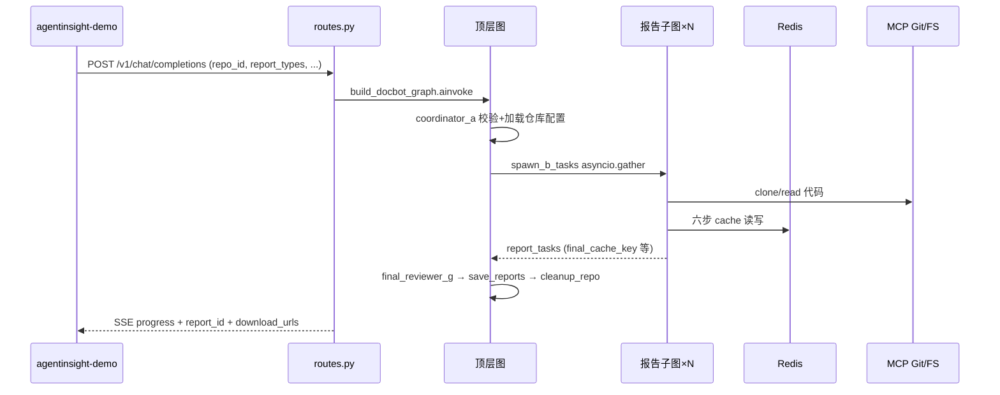
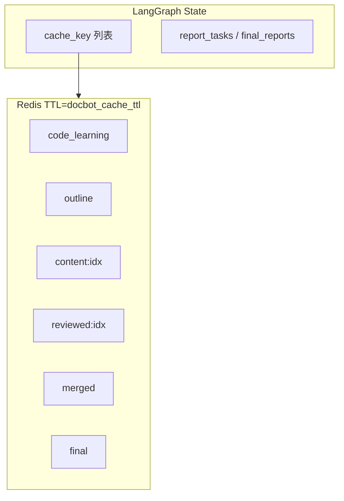
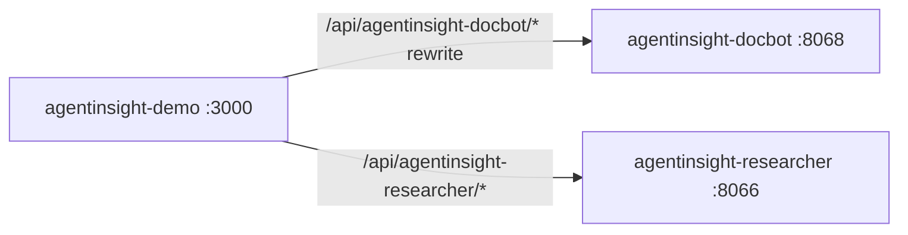

# agentinsight-docbot 技术架构文档

| 元信息 | 值 |
|--------|-----|
| **版本** | v2.0 |
| **日期** | 2026-07-30 |
| **端口** | 8068 |
| **`agent_id`** | `agentinsight-docbot` |
| **Compose 项目名** | `agentinsight-docbot`（与同机 researcher 8066 并存） |
| **真源规则** | 根目录 [`AGENTS.md`](../../AGENTS.md)、本目录 [`AGENTS.md`](../AGENTS.md) |

## 专家审阅角色（≥10）

| 角色 | 职责 / 审阅范围 |
|------|----------------|
| 首席架构师 | 6 步流水线、7 子智能体（A–G）、顶层图 + 报告子图、独立部署边界 |
| LangGraph 编排专家 | `DocbotState` / `ReportTaskState`、`builder.py` / `report_builder.py`、D–E 循环 |
| RAG/检索工程师 | 代码分块索引、`repo_id` namespace、混合检索 |
| LLM 网关工程师 | FAST/SMART/STRATEGIC 三级模型与降级链 |
| FastAPI/API 专家 | `routes.py`、`repo_routes.py`、SSE progress 字段 |
| PostgreSQL/数据隔离专家 | `user_git_repos`、报告表、`agent_id` 固定 docbot |
| Qdrant/向量库专家 | 仓库向量隔离策略 |
| Redis/缓存专家 | `skills/docbot/cache.py` 六类中间产物键 |
| 可观测性（AgentInsight SDK）专家 | 节点与 `trace_chain`（缓存读写） |
| MCP/工具集成专家 | lifespan 启动 `mcp-server-git` / `filesystem`；`tools/git_mcp.py` |
| 安全合规工程师 | `GIT_CREDENTIAL_KEY` AES-GCM、仓库 URL 白名单 |
| Docker/部署工程师 | 5 容器编排、无 SearXNG |
| 测试/CI 工程师 | `tests/` 与 docbot 专属 e2e |
| 文档工程师 | 与 [`DESIGN_AGENT.md`](./DESIGN_AGENT.md) 分工：本文为顶层架构 SSOT |

---

## 1. 项目定位与能力边界

**定位**：根据用户**代码仓库**一键生成技术文档的多智能体系统，对外 **OpenAI 兼容 API**（SSE 流式，端口 **8068**）。

**流水线**：LangGraph 编排 **7 个逻辑子智能体（A–G）**，完成 **6 步**（代码学习 → 纲要细化 → 内容填充 → 评审 → 合并 → 终审），支持 **8 种文档类型** × **5 种格式** × **2 种语言**。

**能力边界**：

| 支持 | 不支持 |
|------|--------|
| GitHub/GitLab/Gitee 等个人仓库 HTTPS/SSH/Token | 模型训练、前端 SSR |
| 多报告类型 `asyncio.gather` 并发 | `/v1/feedback`、`/v1/ws`、`/v1/mcp/configs`（刻意不暴露） |
| 流式 SSE 进度 + 报告下载 | 与 AIR 代码双向同步（拷贝后独立演进） |

**前端**：全部在 [`agentinsight-demo`](../../agentinsight-demo)（仓库配置、一键生成、进度条、下载）。

**代码复用**：自 `agentinsight-researcher` 拷贝的 `common/`、`rag/`、`llm/`、`memory/`、`observability/` 及部分 `api/`、`skills/researcher/publisher.py` 等在本仓库**独立维护**。

---

## 2. 技术栈与依赖

与根 `AGENTS.md` 一致，**本子项目特征**：

| 项 | 说明 |
|----|------|
| 三级 LLM | `FAST_LLM` / `SMART_LLM` / `STRATEGIC_LLM`（见 `.env.template`） |
| MCP | 系统自带 git + filesystem，**不入** `mcp_configs` 表 |
| 并发派发 | `asyncio.gather` + `Semaphore`（非 LangGraph Send API） |
| 中间产物 | Redis 存内容，State 仅存 `cache_key` |
| PostgreSQL | ≥17，5 容器内含本地 postgres |
| 无 SearXNG | 检索面向仓库 RAG，非 Web 元搜索 |

---

## 3. 目录结构与模块边界

```
agentinsight-docbot/
├── server.py                      # lifespan：MCP 子进程、init_database、Qdrant 预热
├── src/
│   ├── graph/
│   │   ├── state.py               # DocbotState + ReportTaskState
│   │   ├── builder.py             # 顶层图
│   │   ├── report_builder.py      # 报告子图
│   │   ├── nodes.py / report_nodes.py / edges.py
│   ├── agents/docbot/             # A–G 业务逻辑
│   ├── skills/docbot/             # 6 步技能 + cache.py
│   ├── config/docbot/             # personas、outlines/*.yaml、prompts
│   ├── tools/git_mcp.py
│   └── api/repo_routes.py         # /v1/repos CRUD
├── scripts/init.sql               # 基础 DDL + docbot 表（与根 scripts 同步）
└── docker-compose.yml             # postgres/redis/qdrant/embeddings/agent-docbot
```

**临时目录**：克隆路径 `temp/repos/{user_id}/{repo_id}/`（`.gitignore`）。

---

## 4. 核心架构图

### 4.1 端到端请求流



### 4.2 顶层 LangGraph


`spawn_b_tasks` 内对每个 `report_type` 编译并执行 `build_report_subgraph()`，并发受 `Semaphore` 限制。

### 4.3 报告子图（单 report_type）


路由函数：`route_after_d` / `route_after_e`（`src/graph/edges.py`）；章节修订上限 `max_revisions_per_chapter`（默认 3）。

### 4.4 数据流（State 瘦、Redis 胖）



键格式：`docbot:{agent_id}:{user_id}:{session_id}:{type}:{report_type}[:{chapter_idx}]`（`skills/docbot/cache.py`）。

---

## 5. LangGraph State 摘要

**DocbotState**（顶层）：

- `repo_id`、`report_types`、`report_format`、`language`
- `_repo_config`（解密后仓库凭据，敏感，不应长期依赖 Checkpoint 泄露面）
- `report_tasks` / `final_reports`（覆盖语义，非 `operator.add`）
- `errors: Annotated[list, operator.add]`

**ReportTaskState**（子图）：

- `chapters`、`current_chapter_idx`、`review_idx`
- `*_cache_key` 字段族；`content_cache_keys` / `reviewed_cache_keys` 累积
- 输出：`report_id`、`download_urls`、`report_image_svg`

**Checkpoint**：仅顶层图挂 `PostgresSaver`；子图不独立 checkpointer。`thread_id` 顶层 `{agent_id}:{session_id}`；子图配置可含 `{report_type}` 后缀（见 AGENTS.md）。

---

## 6. 子智能体与 6 步映射

| 代号 | 模块 | 步骤 | 典型 LLM  tier |
|------|------|------|----------------|
| A | `coordinator.py` | 入口校验、加载 repo | FAST |
| B | `report_runner.py` | 子图调度 | — |
| C | `code_learner.py` + `outline_skill.py` | 任务一、二 | STRATEGIC |
| D | `content_filler.py` | 任务三 | SMART |
| E | `reviewer.py` | 任务四 | SMART |
| F | `merger.py` | 任务五 | SMART |
| G | `final_reviewer.py` | 任务六 + 顶层终审 | SMART |

默认大纲：`src/config/docbot/outlines/*.yaml`，由 `outlines.py` Pydantic 加载；persona：`DOCBOT_REPORT_PERSONAS`。

---

## 7. API 层

**挂载**（`server.py`）：`/v1` chat + sessions + repos；**无** feedback/ws/mcp CRUD。

| 端点 | 说明 |
|------|------|
| `POST /v1/chat/completions` | 携带 docbot 扩展字段（`repo_id`、`report_types` 等）；SSE `delta.progress` |
| `/v1/repos` | 仓库 CRUD、连接测试、同步（`repo_routes.py`） |
| `/v1/sessions` | 与会话元数据（拷贝自 AIR 并演进） |
| `GET /v1/reports/{id}/download` | 多格式下载 |
| `GET /health` | 健康检查 |

身份解析与 researcher 相同模式（JWT → IP 降级）。

---

## 8. 数据层

**PostgreSQL 专属/共享表**（`scripts/init.sql`）：

| 表 | 用途 |
|----|------|
| `user_git_repos` | 仓库 URL、加密凭据、分支、同步状态 |
| `research_reports` / `chat_messages` 等 | 共享 DDL，`agent_id='agentinsight-docbot'` 隔离 |
| `report_limits` / `daily_report_usage` | IP/用户报告配额 |

**Qdrant**：集合 `agents`；用户仓库索引 namespace 含 `repo_id`（见 `rag/` 实现与 AGENTS.md 第 7 章 docbot 偏差说明）。

**Redis**：除 docbot 流水线键外，通用键仍遵循 `{agent_id}:{user_id}:...` 前缀。

---

## 9. RAG / LLM / MCP

- **仓库加载**：`repo_loader.py` 克隆 → 分块 → 写入 Qdrant + BM25 语料。
- **RAG 检索**：生成章节时召回相关代码片段；`trace_retriever` 包裹检索节点。
- **LLM**：任务一/二 STRATEGIC，三四五六 SMART/FAST 兜底；`LLMClient` 三级降级链。
- **MCP**：`server.py` lifespan 启动 `uvx mcp-server-git` 与 `npx @modelcontextprotocol/server-filesystem`；`GitMCPAdapter` 提供高级 API。
- **导出**：`skills/researcher/publisher.py` 生成 MD/HTML/PDF/DOCX/JSON；可选 `image_generator.py` SVG。

---

## 10. 可观测性

- 编排入口：`trace_agent` 包裹顶层 `graph.ainvoke`（`routes.py`）。
- 缓存管道：`trace_chain` 包裹 `write_cache` / `read_cache`（`cache.py`）。
- LLM/RAG/工具：与 AIR 相同分层规则（generation 仅在 `llm/`）。

---

## 11. 部署

**5 容器**（`docker compose -p agentinsight-docbot -f docker-compose.yml up -d`）：

| 服务 | 端口 |
|------|------|
| `agent-docbot` | **8068** |
| `postgres` | 127.0.0.1:5432 |
| `redis` | 127.0.0.1:6379 |
| `qdrant` | 127.0.0.1:6333 |
| `embeddings` | 8088 |

依赖顺序：`postgres` → `redis` → `qdrant` → `embeddings` → `agent-docbot`（`service_healthy`）。

**三套构建模式**：QA/离线编排与脚本在仓库根目录；本子目录保留生产联网 `Dockerfile` + `docker-compose.yml`。

---

## 12. 与演示平台 / researcher 集成



- Demo 通过 `lib/agents.config.ts` 声明 docbot `features.repoConfig` / `reportGeneration`。
- 两智能体**不** RPC 互调；用户在同一 UI 切换 Agent。

---

## 13. 关键环境变量（占位符）

| 变量 | 说明 |
|------|------|
| `FAST_LLM` / `SMART_LLM` / `STRATEGIC_LLM` | 三级模型 |
| `GIT_CREDENTIAL_KEY` | 仓库凭据 AES-GCM（32 字节 base64） |
| `ALLOWED_GIT_DOMAINS` | 克隆 URL 白名单 |
| `MAX_REPO_SIZE_MB` / `DOCBOT_CACHE_TTL` | 仓库与 Redis TTL |
| `POSTGRES_*` / `REDIS_*` / `QDRANT_*` / `EMBEDDINGS_*` | 基础设施 |
| `SELF_HOST` / `IP_DAILY_REPORT_LIMIT` | 身份与配额 |
| `AGENTINSIGHT_*` | 追踪 |

详见 `.env.template`。

---

## 14. 配套文档

- 代码级设计：[`DESIGN_AGENT.md`](./DESIGN_AGENT.md)
- 前端交互（已迁移）：[`../agentinsight-demo/docs/ARCHITECTURE.md`](../../agentinsight-demo/docs/ARCHITECTURE.md)
- 8 种文档默认大纲：`src/config/docbot/outlines/*.yaml`（原独立 OUTLINE.md 已迁移）
