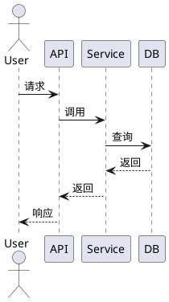

<!--
======================================================================
使用说明（请在生成最终文档时删除此注释块）
======================================================================

1. 本文件为「技术架构文档模板」，含 21 章 + 附录，每章包含：
   - 章节占位符 `<...>`：需替换为实际内容
   - 「撰写提示」blockquote：给写作者的指导，最终文档可删除
   - 「示例」表格/代码：可直接套用

2. 占位符约定：
   - <必填项>            必填
   - [<可选项>]          可选
   - {{TODO: 说明}}      待补全
   - {{DECISION: 说明}}  待决策

3. 填写顺序建议：
   a. 第 0 章（元信息）→ 第 1 章（执行摘要，先写一版草稿，最后回填）
   b. 第 2、3、4 章（业务上下文、领域模型）— 业务架构师 + DDD 主笔
   c. 第 5 章（原则与 ADR）→ 第 6、7 章（容器/组件视图）
   d. 第 8-17 章（数据/API/集成/安全/可观测/可靠/性能/AI/基础设施/DevOps）
   e. 第 18-20 章（成本/治理/风险）
   f. 最后回填执行摘要与第 21 章附录索引

4. 转 Word 方法：
   - VS Code 装 Pandoc + Markdown Preview Enhanced 插件
   - 命令：pandoc ARCHITECTURE_TEMPLATE.md -o ARCHITECTURE.docx --toc --toc-depth=3
   - 或用 Typora / WPS 直接导出 docx
   - 如需样式可控：pandoc ARCHITECTURE_TEMPLATE.md -o ARCHITECTURE.docx --reference-doc=reference.docx

5. 推荐配套文件：
   - ADRs/ 目录（每条决策一份 ADR-NNN-标题.md）
   - diagrams/ 目录（PlantUML / drawio / Mermaid 源文件）
   - spectra/ 目录（架构治理 Fitness Function）
======================================================================
-->

# <系统名> 技术架构文档

> **一句话定位**：<在此用 1 句话描述系统是什么、为谁、解决什么问题>
>
> **文档版本**：v1.0 ｜ **状态**：Draft ｜ **最后更新**：2026-07-20

---

## 目录

- [0. 文档元信息](#0-文档元信息)
- [1. 执行摘要](#1-执行摘要)
- [2. 业务上下文与目标](#2-业务上下文与目标)
- [3. 系统上下文与范围](#3-系统上下文与范围)
- [4. 领域模型与限界上下文](#4-领域模型与限界上下文)
- [5. 架构原则与决策](#5-架构原则与决策)
- [6. 容器级架构（C4 L2）](#6-容器级架构c4-l2)
- [7. 组件级架构（C4 L3）](#7-组件级架构c4-l3)
- [8. 数据架构](#8-数据架构)
- [9. 应用架构与 API 设计](#9-应用架构与-api-设计)
- [10. 集成架构](#10-集成架构)
- [11. 安全与合规架构](#11-安全与合规架构)
- [12. 可观测性与运行态架构](#12-可观测性与运行态架构)
- [13. 可靠性与韧性设计](#13-可靠性与韧性设计)
- [14. 性能与可扩展性](#14-性能与可扩展性)
- [15. AI / 智能能力架构](#15-ai--智能能力架构如适用)
- [16. 基础设施与部署架构](#16-基础设施与部署架构)
- [17. 交付与 DevOps](#17-交付与-devops)
- [18. 成本与可持续性](#18-成本与可持续性)
- [19. 架构治理与演进](#19-架构治理与演进)
- [20. 风险与未决事项](#20-风险与未决事项)
- [21. 附录](#21-附录)

---

## 0. 文档元信息

### 0.1 文档版本与变更历史

| 版本 | 日期 | 作者 | 变更摘要 | 评审状态 |
|------|------|------|---------|---------|
| v0.1 | YYYY-MM-DD | <作者> | <初始草案，搭建纲要> | {{TODO}} |
| v1.0 | YYYY-MM-DD | <作者> | <正式发布版本说明> | {{TODO}} |

### 0.2 评审记录

| 评审轮次 | 日期 | 评审人 | 主要意见 | ADR 编号 | 结论 |
|---------|------|--------|---------|---------|------|
| 1 | YYYY-MM-DD | <评审人> | <意见摘要> | ADR-005 | 通过/驳回/待补 |

### 0.3 文档状态

- **当前状态**：{{Draft / Reviewed / Approved / Deprecated}}
- **生命周期所有者**：<姓名/团队>
- **下次评审日期**：YYYY-MM-DD
- **归档位置**：<Wiki / Confluence / Git 链接>

### 0.4 读者画像与阅读路径

> **撰写提示**：明确不同读者的推荐阅读路径，避免"一份文档给所有人看"导致的过载。每位读者画像下用 1-2 行说明。

| 读者角色 | 阅读路径（推荐章节） | 关注重点 |
|---------|-------------------|---------|
| 决策者（CEO/CTO/产品负责人） | §1 → §2 → §5 → §18 | 投资回报、风险、里程碑 |
| 开发工程师 | §3 → §4 → §6 → §7 → §9 → §11 | 如何落地代码 |
| 运维 / SRE | §12 → §13 → §16 → §17 | 如何稳定运行 |
| 安全 / 合规审计 | §11 → §15.7 → §19 | 风险与合规 |
| 架构治理委员会 | §5 → §19 → §20 | 治理与演进 |

### 0.5 术语表与缩略语

> **撰写提示**：把领域语言（Ubiquitous Language）和缩略语集中维护；术语变更必须经 DDD 架构师确认。

| 术语 / 缩略语 | 全称 | 释义 | 引用来源 |
|-------------|------|------|---------|
| <术语> | <Full Name> | <释义> | <文档链接> |

---

## 1. 执行摘要

> **撰写提示**：本章为"电梯演讲"，500-800 字。先写草稿，待全篇完成后再回填；决策者读完此章应能做出"是否继续看"的判断。

### 1.1 业务问题与机会（Why Now）

<3-5 句话描述：当前业务痛点、市场窗口、监管/技术趋势变化、不做此项的代价>

### 1.2 解决方案一句话概括

<一句话描述系统提供的能力与服务对象>

### 1.3 核心架构决策 Top 5

| # | 决策 | 一句话理由 | 对应 ADR |
|---|------|-----------|---------|
| 1 | <如：采用微服务 + 事件驱动> | <理由> | ADR-001 |
| 2 | <...> | <理由> | ADR-002 |

### 1.4 关键质量目标

| 维度 | 指标 | 目标值 | 验证方式 |
|------|------|-------|---------|
| 可用性 | 月度 SLA | ≥ 99.95% | §12.1 SLI/SLO |
| 性能 | P99 延迟 | ≤ 200ms | §14 压测 |
| RTO / RPO | 灾备恢复 | ≤ 15min / ≤ 5min | §13.3 DR 演练 |
| 安全 | 严重漏洞修复 SLA | ≤ 7 天 | §11 合规审计 |

### 1.5 投资与风险摘要

- **预估投资**：<人力 / 基础设施 / 第三方采购>
- **关键风险 Top 3**：<一句话风险 + 详见 §20>

### 1.6 与战略目标的映射关系

| 公司战略目标 | 本系统贡献方式 | 关键指标 |
|------------|-------------|---------|
| <战略目标 1> | <贡献描述> | <KPI> |

---

## 2. 业务上下文与目标

### 2.1 业务背景与战略对齐

> **撰写提示**：写清楚业务从何处来、要往何处去。引用 OKR / 北极星指标时，给出文档出处。

<业务背景描述>

**战略对齐**：
- OKR：<目标 / 关键结果>
- 北极星指标：<指标定义与公式>

### 2.2 利益相关方地图

| 利益相关方 | 角色 | 关注点 | 影响力 | 参与方式 |
|----------|------|-------|-------|---------|
| <利益相关方> | 决策者/使用者/运维者 | <关注点> | 高/中/低 | <周报/评审会/RFC> |

### 2.3 业务能力地图

> **撰写提示**：用业务能力地图（Business Capability Map）作为业务-IT 对齐的桥梁，避免技术地图直接覆盖业务。

```
<业务能力 1>
├── <子能力 1.1>
├── <子能力 1.2>
<业务能力 2>
├── <子能力 2.1>
```

### 2.4 业务用例与场景

| 用例编号 | 名称 | 主参与者 | 前置条件 | 主流程 | 业务价值 |
|--------|------|---------|---------|-------|---------|
| UC-01 | <用例名> | <角色> | <前置> | <步骤> | <价值> |

[附：用例图 — 见 diagrams/use-case.puml]

### 2.5 业务约束

| 类别 | 约束 | 来源 |
|------|------|------|
| 合规 | <约束> | <监管文件> |
| 时间窗 | <约束> | <市场节点> |
| 行业 | <约束> | <行业标准> |

### 2.6 假设与依赖

- **假设**：{{TODO}}
- **外部依赖**：{{TODO}}

---

## 3. 系统上下文与范围

### 3.1 系统边界定义

| 范围 | 项 | 说明 |
|------|----|----|
| ✅ In-Scope | <项> | <说明> |
| ❌ Out-of-Scope | <项> | <说明> |

### 3.2 系统上下文图（C4 Level 1）

> **撰写提示**：C4 L1 仅画"系统本身 + 外部依赖方 + 用户角色"，不画内部细节。建议用 PlantUmer 或 drawio 源文件保存于 diagrams/context-l1.puml。

```plantuml
@startuml context-l1
!include https://raw.githubusercontent.com/plantuml-stdlib/C4-PlantUML/master/C4_Context.puml

Person(user, "<用户角色>")
System(sys, "<系统名>", "<一句话职责>")
System_Ext(ext1, "<外部系统 1>", "<协议>")

Rel(user, sys, "<动作>")
Rel(sys, ext1, "<动作>", "<协议>")
@enduml
```

### 3.3 外部系统与接口清单

| 外部系统 | 方向 | 协议 | 数据格式 | 频次 | SLA | 责任方 |
|---------|------|------|---------|------|-----|-------|
| <系统名> | 上游/下游 | HTTP/Kafka | JSON/Avro | QPS | <SLA> | <团队> |

### 3.4 用户角色与权限模型

| 角色 | 描述 | 关键权限 | 数据范围 |
|------|------|---------|---------|
| <角色> | <描述> | <权限列表> | <范围> |

[附：RACI 矩阵 — 见附录 D]

### 3.5 部署上下文

<多区域 / 多云 / 混合云 / 边缘节点 的部署拓扑概述，详细图见 §16>

---

## 4. 领域模型与限界上下文

> **撰写提示**：本章由 DDD 架构师主笔。先画限界上下文地图，再展开聚合与领域事件，确保业务语义对齐。

### 4.1 限界上下文地图

```
+----------------+        +----------------+
|  <上下文 A>    |--合作关系-|  <上下文 B>    |
+----------------+        +----------------+
        |
   客户-供应商
        |
+----------------+
|  <上下文 C>    |
+----------------+
```

| 上下文 | 类型 | 职责 | 团队 | 关键关系 |
|-------|------|------|------|---------|
| <上下文 A> | 核心域 | <职责> | <团队> | 合作/共享内核/客户-供应商/ACL |

### 4.2 核心域 / 支撑域 / 通用域分层

| 域类型 | 上下文 | 投入策略 |
|-------|-------|---------|
| 核心域 | <列表> | 自研 + 重投入 |
| 支撑域 | <列表> | 自研 + 适度投入 |
| 通用域 | <列表> | 采购 / 开源 |

### 4.3 关键聚合与实体

```plantuml
@startuml aggregate-example
class <AggregateRoot> {
  - id: AggregateId
  - field1: Type
  + behavior1()
}
class <Entity> { }
class <ValueObject> { }

<AggregateRoot> "1" *-- "many" <Entity>
<AggregateRoot> "1" *-- "1" <ValueObject>
@enduml
```

### 4.4 领域事件清单

| 事件 | 发布方 | 订阅方 | 载荷 | 触发场景 |
|------|-------|-------|------|---------|
| <EventName> | <上下文> | <上下文> | <Schema> | <场景> |

### 4.5 Ubiquitous Language 统一语言词典

> **撰写提示**：维护术语的一致性是 DDD 的核心。任何术语变更必须经领域架构师确认并广播。

| 中文术语 | 英文术语 | 释义 | 同义词（禁用） |
|---------|---------|------|-------------|
| <术语> | <Term> | <释义> | <不要使用> |

### 4.6 关键业务流程

[附：BPMN / UML 活动图 — 见 diagrams/process-<name>.puml]

---

## 5. 架构原则与决策

### 5.1 架构原则

> **撰写提示**：原则不超过 12 条，每条含"原则-理由-含义-反例"。强制可被检验。

| # | 原则 | 理由 | 含义 | 反例 |
|---|------|------|------|------|
| 1 | API 优先 | <理由> | <含义> | <反例> |
| 2 | 无状态服务 | <理由> | <含义> | <反例> |

### 5.2 设计准则

| 类别 | 准则 |
|------|------|
| 接口 | RESTful 资源命名 / 版本化 / 幂等键 |
| 一致性 | 优先最终一致性 / Saga 跨域 |
| 失败 | 失败优雅 / Bulkhead / 熔断 |

### 5.3 关键架构决策记录（ADR）

> **撰写提示**：每条 ADR 单独文件存放于 ADRs/ADR-NNN-标题.md，本章只放索引与一句话摘要。

| ADR 编号 | 标题 | 状态 | 决策摘要 | 链接 |
|---------|------|------|---------|------|
| ADR-001 | <标题> | Accepted | <一句话决策> | [链接](../ADRs/ADR-001-xxx.md) |

**ADR 模板**（每条单独文档使用）：

```markdown
# ADR-NNN：<标题>

- **状态**：Proposed / Accepted / Deprecated / Superseded by ADR-XXX
- **日期**：YYYY-MM-DD
- **决策者**：<姓名>

## 上下文
<问题背景、约束、触发因素>

## 决策
<选择的方案>

## 备选方案
- 方案 A：<描述> — 优势 / 劣势
- 方案 B：<描述> — 优势 / 劣势

## 后果
- 正面：<...>
- 负面：<...>
- 缓解：<...>

## 合规影响
<相关合规要求>
```

### 5.4 技术选型矩阵

| 层 | 候选 1 | 候选 2 | 候选 3 | 选择 | 评分依据 | ADR |
|----|-------|-------|-------|------|---------|-----|
| 前端 | <...> | <...> | <...> | <最终> | <理由> | ADR-003 |
| 网关 | <...> | <...> | <...> | <最终> | <理由> | ADR-004 |

### 5.5 反模式清单

| # | 反模式 | 不采用理由 | 替代方案 |
|---|-------|----------|---------|
| 1 | <反模式> | <理由> | <替代> |

---

## 6. 容器级架构（C4 L2）

### 6.1 容器级架构图

> **撰写提示**：C4 L2 展示"部署单元 + 技术栈 + 主要交互"。每个容器是独立部署单元。

```plantuml
@startuml container-l2
!include https://raw.githubusercontent.com/plantuml-stdlib/C4-PlantUML/master/C4_Container.puml

System_Boundary(sys, "<系统名>") {
  Container(api, "API 服务", "FastAPI/Python", "对外 API")
  Container(worker, "异步 Worker", "Celery", "异步任务")
  ContainerDb(db, "主数据库", "PostgreSQL", "业务数据")
}

Rel(api, db, "读写")
@enduml
```

### 6.2 容器职责说明

| 容器 | 技术栈 | 职责（SRP） | 团队 | 部署形态 |
|------|-------|------------|------|---------|
| <容器名> | <技术栈> | <一句话职责> | <团队> | <K8s Deployment / Serverless / VM> |

### 6.3 容器间交互

| 调用方 | 被调用方 | 协议 | 同步/异步 | 超时 | 重试 | 熔断 |
|-------|---------|------|----------|------|------|------|
| <容器> | <容器> | gRPC | 同步 | 500ms | 3 次 | ✅ |

### 6.4 部署拓扑

<Namespace / 节点池 / Region / AZ 划分说明，详细图见 §16>

### 6.5 数据流图

<数据从入口到出口的全链路描述，含同步流与异步流>

---

## 7. 组件级架构（C4 L3）

### 7.1 核心容器组件分解图

> **撰写提示**：仅对核心容器展开 L3，无需对每个容器都画。

```plantuml
@startuml component-l3
!include https://raw.githubusercontent.com/plantuml-stdlib/C4-PlantUML/master/C4_Component.puml

Container_Boundary(api, "API 服务") {
  Component(ctrl, "Controller", "FastAPI", "路由")
  Component(svc, "Service", "Python", "业务逻辑")
  Component(repo, "Repository", "Python", "数据访问")
}

Rel(ctrl, svc, "调用")
Rel(svc, repo, "调用")
@enduml
```

### 7.2 关键模块职责与接口

| 模块 | 职责 | 接口契约 | 负责人 |
|------|------|---------|-------|
| <模块> | <职责> | <契约链接> | <姓名> |

### 7.3 依赖关系图

<模块依赖关系，标注依赖方向；附 ArchUnit / OPA 检查规则>

### 7.4 包/模块结构

```
project-root/
├── <package-1>/
│   ├── __init__.py
│   ├── api/
│   ├── domain/
│   ├── application/
│   └── infrastructure/
└── <package-2>/
```

### 7.5 关键流程时序图



---

## 8. 数据架构

### 8.1 数据分类与生命周期

| 数据类别 | 示例 | 创建 | 存储 | 使用 | 归档 | 销毁 |
|---------|------|------|------|------|------|------|
| 业务数据 | <示例> | <来源> | <位置> | <使用方> | <归档策略> | <销毁方式> |
| 日志数据 | <示例> | <...> | <...> | <...> | <...> | <...> |

### 8.2 数据模型

#### 8.2.1 概念模型

<ER 概念图 — 实体与关系>

#### 8.2.2 逻辑模型

<ER 逻辑图 — 含主外键>

#### 8.2.3 物理模型

<表结构 DDL — 见附录或迁移脚本链接>

### 8.3 存储选型矩阵

| 数据类型 | 选型 | 理由 | 数据量级 | 读写 QPS | ADR |
|---------|------|------|---------|---------|-----|
| OLTP | PostgreSQL | <理由> | <量级> | <QPS> | ADR-005 |
| 缓存 | Redis | <理由> | <量级> | <QPS> | ADR-006 |
| 搜索 | OpenSearch | <理由> | <量级> | <QPS> | ADR-007 |
| 对象 | S3/MinIO | <理由> | <量级> | <QPS> | ADR-008 |

### 8.4 数据流与集成

| 流 | 源 | 目标 | 工具 | 频次 | 延迟 |
|----|----|------|------|------|------|
| CDC | PostgreSQL | Kafka | Debezium | 实时 | <1s |
| ETL | <源> | <数据仓库> | Airflow | T+1 | 1h |

### 8.5 数据治理

- **数据所有权**：<谁拥有什么数据>
- **数据血缘**：<工具 / 维护方式>
- **数据质量指标**：<完整性 / 一致性 / 时效性>
- **主数据管理 (MDM)**：<主数据定义>

### 8.6 数据安全

- **静态加密**：{{TODO}}
- **传输加密**：TLS 1.3
- **字段级脱敏**：<脱敏规则>
- **KMS 集成**：<密钥管理方式>

### 8.7 数据合规

| 法规 | 适用范围 | 关键义务 | 落地措施 |
|------|---------|---------|---------|
| GDPR / 个保法 | <范围> | <义务> | <措施> |

---

## 9. 应用架构与 API 设计

### 9.1 服务划分原则

> **撰写提示**：服务划分应严格对应 DDD 限界上下文，避免按技术分层切服务。引用 Team Topologies。

<服务划分原则描述>

### 9.2 服务清单

| 服务 | 职责 | 团队 | SLA | 关键依赖 | 部署 |
|------|------|------|-----|---------|------|
| <服务名> | <职责> | <团队> | <SLA> | <依赖> | <形态> |

### 9.3 API 设计规范

- **协议选型**：REST / GraphQL / gRPC
- **版本策略**：URI 版本 `/v1/` vs Header 版本
- **命名规范**：复数名词 / kebab-case
- **错误模型**：统一错误结构（code / message / details / traceId）
- **分页**：cursor-based
- **幂等性**：幂等键机制

### 9.4 API 契约

> **撰写提示**：所有 API 契约应通过 OpenAPI / Protobuf 文件维护于独立仓库或目录，本章只放索引。

| API | 版本 | 契约文件 | 维护方 |
|-----|------|---------|-------|
| <API 名> | v1 | [openapi.yaml](link) | <团队> |

### 9.5 通信模式

| 模式 | 场景 | 技术 | 备注 |
|------|------|------|------|
| 同步 RPC | <场景> | gRPC/HTTP | <备注> |
| 异步消息 | <场景> | Kafka | <备注> |
| 事件驱动 | <场景> | Kafka Streams | <备注> |

**事件 Schema Registry**：<维护方式 / 兼容性策略>

### 9.6 一致性策略

| 场景 | 模式 | 实现方式 |
|------|------|---------|
| 跨服务事务 | Saga | 编排 / 协同 |
| 短事务 | TCC | <实现> |
| 事件可靠投递 | Outbox | <实现> |
| 幂等 | 幂等键 | <键规则> |

### 9.7 缓存策略

| 缓存层 | 技术 | 失效策略 | 防穿透 | 防雪崩 |
|-------|------|---------|-------|-------|
| 本地 | Caffeine | TTL | 布隆过滤器 | 随机 TTL |
| 分布式 | Redis | LRU + TTL | 空值缓存 | 锁竞争 |

---

## 10. 集成架构

### 10.1 集成拓扑

<集成模式：点对点 / 总线 / 网关 / 事件网格>

### 10.2 API 网关与 BFF

| 能力 | 实现 |
|------|------|
| 路由 | <网关产品> |
| 鉴权 | OAuth2 / JWT |
| 限流 | 令牌桶 |
| 配额 | 按 tenant |
| 协议转换 | HTTP↔gRPC |

### 10.3 消息中间件

- **Topic/Queue 拓扑**：<列表>
- **分区策略**：<key 规则>
- **顺序保证**：<分区顺序 / 全局顺序>
- **重试与死信**：<策略>

### 10.4 外部系统集成清单

| 系统 | 协议 | 数据量 | 频次 | SLA | 责任方 |
|------|------|-------|------|-----|-------|
| <外部系统> | HTTP | <量级> | <频次> | <SLA> | <团队> |

### 10.5 ESB / iPaaS / 服务网格选型

<选型说明与边界>

### 10.6 数据交换标准

<EDI / FHIR / ISO20022 / 自定义 等>

---

## 11. 安全与合规架构

> **撰写提示**：本章为合规红线章节，所有条目必须可被审计验证。安全架构师主笔。

### 11.1 安全模型与零信任架构

<零信任五层模型：身份-设备-网络-应用-数据>

### 11.2 身份与访问管理 (IAM)

- **认证**：OAuth2 / OIDC / SAML
- **授权**：RBAC + ABAC
- **SSO**：<实现>
- **MFA**：<策略>
- **会话管理**：<超时 / 续期>

### 11.3 威胁建模

> **撰写提示**：使用 STRIDE 方法对每个核心组件进行威胁建模。

| 组件 | 威胁 (STRIDE) | 风险等级 | 缓解措施 | 验证方式 |
|------|--------------|---------|---------|---------|
| <组件> | Spoofing | 高 | <措施> | 渗透测试 |

### 11.4 密钥与机密管理

- **KMS / HSM**：<选型>
- **机密存储**：Vault / Secrets Manager
- **轮转策略**：<周期>
- **访问审计**：<日志位置>

### 11.5 网络安全

- **VPC 划分**：<拓扑>
- **微分段**：<策略>
- **WAF**：<规则集>
- **DDoS 防护**：<方案>
- **出入站规则**：<表>

### 11.6 应用安全

| 检查类型 | 工具 | 集成点 | 阻断策略 |
|---------|------|-------|---------|
| SAST | <工具> | PR / CI | 严重级阻断 |
| DAST | <工具> | 预发扫描 | 高危阻断 |
| SCA | <工具> | CI | CVE 高危阻断 |
| IAST | <工具> | 测试运行时 | 提示 |
| RASP | <工具> | 生产运行时 | 阻断 |

### 11.7 合规框架映射

| 合规框架 | 控制项 | 落地措施 | 证据位置 |
|---------|-------|---------|---------|
| ISO 27001 | A.5-A.18 | <措施> | <文档> |
| SOC 2 | CC1-CC7 | <措施> | <文档> |
| 等保 2.0 | <级别> | <措施> | <文档> |
| PCI-DSS | <范围> | <措施> | <文档> |

### 11.8 审计与取证

- **日志留存**：<时长 / 不可篡改>
- **审计链路**：<端到端追溯>
- **取证流程**：<事件响应>

---

## 12. 可观测性与运行态架构

### 12.1 SLI / SLO / SLA 定义

| 服务 | SLI（指标） | SLO（目标） | SLA（对外承诺） | 错误预算 |
|------|------------|------------|---------------|---------|
| <服务> | 可用率 = 成功请求/总请求 | 99.95% | 99.9% | 43.2 min/月 |

### 12.2 监控体系

> **撰写提示**：监控三支柱（Metrics / Logging / Tracing）+ Profiling。

| 支柱 | 工具 | 采集 | 存储 | 查询 |
|------|------|------|------|------|
| Metrics | Prometheus | pull | TSDB | PromQL |
| Logging | Loki/ELK | push | <存储> | <查询> |
| Tracing | Jaeger/Tempo | OTLP | <存储> | <查询> |
| Profiling | Pyroscope | eBPF | <存储> | <查询> |

### 12.3 指标体系

- **USE**（资源）：Utilization / Saturation / Errors
- **RED**（请求）：Rate / Errors / Duration
- **黄金信号**：Latency / Traffic / Errors / Saturation

### 12.4 告警策略

| 级别 | 触发条件 | 路由 | 值班 | Runbook |
|------|---------|------|------|---------|
| P0 | SLO 烧速 > 2x | 电话+短信 | 7×24 | [链接](link) |
| P1 | <条件> | IM | 工作时间 | [链接](link) |

### 12.5 日志架构

- **结构化日志**：JSON 格式，必含 traceId / spanId / userId
- **采集**：Filebeat / Vector
- **聚合**：<位置>
- **检索**：<工具>
- **保留**：<时长>

### 12.6 分布式追踪

- **Trace 上下文**：W3C Trace Context
- **采样策略**：<头部采样 / 尾部采样比例>
- **根因分析**：<能力>

### 12.7 混沌工程

- **工具**：Chaos Mesh / Gremlin
- **演练计划**：<频率 / 范围>
- **回归基线**：<指标>

### 12.8 容量与水位管理

- **容量基线**：<当前峰值>
- **扩缩容阈值**：<触发条件>
- **容量评审节奏**：<月度 / 季度>

---

## 13. 可靠性与韧性设计

### 13.1 故障域与爆炸半径

- **Cell 架构**：<是否启用>
- **隔离策略**：<租户 / 区域>
- **Bulkhead**：<线程 / 连接池隔离>

### 13.2 高可用拓扑

| 服务 | 多活 | 主备 | 故障转移 |
|------|------|------|---------|
| <服务> | 同城双活 | — | 自动 |

### 13.3 灾备策略

| 维度 | 目标 | 实现 | 演练频率 |
|------|------|------|---------|
| RTO | ≤ 15 min | <方案> | 季度 |
| RPO | ≤ 5 min | <方案> | 季度 |

### 13.4 限流 / 熔断 / 降级 / 重试 / 背压

| 策略 | 实现 | 触发条件 | 行为 |
|------|------|---------|------|
| 限流 | Sentinel | <条件> | 拒绝 |
| 熔断 | Resilience4j | <条件> | 快速失败 |
| 降级 | <工具> | <条件> | 返回兜底 |
| 重试 | <工具> | <条件> | 指数退避 |
| 背压 | Reactive Streams | <条件> | 反压上游 |

### 13.5 数据备份与恢复

- **备份策略**：<全量 + 增量 + 日志>
- **恢复演练**：<频率>
- **不可变备份**：<是否启用 WORM>

### 13.6 故障注入与 GameDay

<演练计划>

---

## 14. 性能与可扩展性

### 14.1 性能目标

| 接口 | P50 | P95 | P99 | 吞吐 | 并发 |
|------|-----|-----|-----|------|------|
| <接口> | 50ms | 100ms | 200ms | 1000 QPS | 500 |

### 14.2 容量规划

- **当前基线**：<峰值数据>
- **预测增长率**：<月增 %>
- **扩容路径**：<垂直 → 水平 → 分区>

### 14.3 扩展模型

| 维度 | 策略 |
|------|------|
| 水平扩展 | <策略> |
| 垂直扩展 | <策略> |
| 读副本 | <策略> |
| 分区 | <策略> |
| 缓存 | <策略> |

### 14.4 关键瓶颈分析与优化

| 瓶颈 | 位置 | 优化方案 | 责任人 |
|------|------|---------|-------|
| <瓶颈> | <位置> | <方案> | <姓名> |

### 14.5 压测方案

- **场景**：<列表>
- **数据量**：<量级>
- **工具**：k6 / JMeter / Locust
- **报告模板**：<链接>

### 14.6 性能预算

| 层 | 预算 | 实测 |
|----|------|------|
| 前端 | 100ms | <实测> |
| 后端 | 80ms | <实测> |
| 数据库 | 20ms | <实测> |

---

## 15. AI / 智能能力架构（如适用）

> **撰写提示**：本章是当代架构文档必备但业界常缺的章节。AI 架构师主笔。若系统不涉及 AI，可整章标注"不适用"。

### 15.1 AI 用例与能力地图

| 用例 | AI 能力 | 业务价值 | 优先级 |
|------|--------|---------|-------|
| <用例> | 推荐 / 分类 / 生成 / Agent | <价值> | P0 |

### 15.2 模型生命周期

```
数据采集 → 特征工程 → 训练 → 评估 → 部署 → 监控 → 退役
```

| 阶段 | 工具 / 平台 | 责任方 |
|------|-----------|-------|
| 数据 | <工具> | <团队> |
| 训练 | <工具> | <团队> |
| 评估 | <工具> | <团队> |
| 部署 | <工具> | <团队> |
| 监控 | <工具> | <团队> |

### 15.3 特征平台与数据科学工作台

- **特征存储**： Feast / 自研
- **特征版本化**：<策略>
- **数据科学工作台**：JupyterHub / Vertex AI Workbench

### 15.4 推理服务架构

| 模式 | 框架 | 路由 | 延迟 |
|------|------|------|------|
| 在线 | Triton / vLLM | <路由> | <ms> |
| 批 | Batch | — | <h> |
| 流式 | KServe | <路由> | <ms> |

### 15.5 LLM / Agent 架构

- **Prompt 编排**：LangChain / LangGraph / 自研
- **RAG**：<向量库 / 检索策略 / Rerank>
- **Tool Use**：MCP / Function Calling
- **护栏 (Guardrails)**：<内容安全 / 越狱防护>
- **Agent 编排**：<单 Agent / 多 Agent / Hierarchical>

### 15.6 模型可观测性

| 指标 | 类型 | 阈值 |
|------|------|------|
| 数据漂移 | PSI / KS | > 0.2 告警 |
| 概念漂移 | 准确率下降 | > 5% 告警 |
| 公平性 | Demographic Parity | <阈值> |
| 可解释性 | SHAP / LIME | <覆盖度> |

### 15.7 AI 治理与合规

- **数据出处**：<数据来源登记>
- **模型卡 (Model Card)**：<模板与位置>
- **人在回路 (HITL)**：<关键决策点>
- **滥用防护**：<措施>

---

## 16. 基础设施与部署架构

### 16.1 云平台选型与拓扑

<公有云 / 私有云 / 混合云 / 边缘 选型与拓扑图>

### 16.2 网络架构

- **VPC**：<CIDR / 子网划分>
- **对等连接**：<列表>
- **出口**：<NAT / 代理>
- **CDN**：<选型>
- **DNS**：<解析策略>

### 16.3 计算与容器平台

- **K8s 集群划分**：<prod / staging / dev>
- **节点池策略**：<按 workload 类型>
- **Serverless**：<使用范围>

### 16.4 存储架构

| 类型 | 选型 | 容量 | IOPS | 备份 |
|------|------|------|------|------|
| 块 | EBS / 云盘 | <量> | <值> | <策略> |
| 文件 | NAS | <量> | <值> | <策略> |
| 对象 | S3 / OSS | <量> | — | <策略> |

### 16.5 IaC 与 GitOps

- **IaC 工具**：Terraform / Pulumi
- **状态管理**：<远程 backend>
- **GitOps**：ArgoCD / Flux
- **流水线**：<描述>

### 16.6 环境策略

| 环境 | 用途 | 数据 | 一致性保证 |
|------|------|------|----------|
| Dev | 开发自测 | Mock | IaC 同源 |
| Test | QA | 脱敏 | IaC 同源 |
| Staging | 预发 | 生产快照 | IaC 同源 |
| Prod | 生产 | 真实 | IaC 同源 |

### 16.7 多云 / 混合云治理

- **统一身份**：<方案>
- **配额管理**：<方案>
- **成本归集**：<方案>

---

## 17. 交付与 DevOps

### 17.1 价值流地图

```
Idea → Backlog → Dev → CI → CD → Prod → Operate → Learn
```

### 17.2 CI/CD 流水线

| 阶段 | 工具 | 阻断条件 | 产物 |
|------|------|---------|------|
| 构建 | <工具> | 编译失败 | 镜像 |
| 测试 | <工具> | 单测/集成失败 | 报告 |
| 扫描 | <工具> | SAST/SCA 高危 | 报告 |
| 部署 | <工具> | 人工审批 | 部署记录 |
| 验证 | <工具> | 冒烟失败 | 回滚 |

### 17.3 发布策略

| 策略 | 场景 | 工具 |
|------|------|------|
| 蓝绿 | <场景> | Argo Rollouts |
| 金丝雀 | <场景> | Argo Rollouts |
| 特征开关 | <场景> | LaunchDarkly / Unleash |
| 灰度 | <场景> | Istio |

### 17.4 制品与供应链安全

- **SBOM**：<生成工具 / 存储位置>
- **镜像签名**：Cosign / Notation
- **镜像扫描**：Trivy / Grype
- **SLSA 等级**：目标 Level 3

### 17.5 内部开发者平台 (IDP)

- **黄金路径**：<模板列表>
- **服务模板**：<位置>
- **开发者门户**：Backstage / 自研

### 17.6 环境配置与密钥注入

<策略描述>

### 17.7 DORA 指标目标

| 指标 | 目标 | 当前 |
|------|------|------|
| 部署频率 | 每日多次 | <实测> |
| 变更前置时间 | <1 天 | <实测> |
| MTTR | <1 小时 | <实测> |
| 变更失败率 | <5% | <实测> |

---

## 18. 成本与可持续性

### 18.1 成本模型

| 维度 | 月成本 | 占比 |
|------|-------|------|
| 计算 | <值> | <%> |
| 存储 | <值> | <%> |
| 网络 | <值> | <%> |
| 第三方 | <值> | <%> |

### 18.2 成本优化机会

| 机会 | 节省 | 落地难度 |
|------|------|---------|
| 预留实例 | <值> | 低 |
| Spot 实例 | <值> | 中 |
| 右尺寸 | <值> | 低 |
| 闲置回收 | <值> | 低 |

### 18.3 单位经济成本

| 指标 | 公式 | 当前值 |
|------|------|-------|
| Cost per Request | 总成本/请求数 | <值> |
| Cost per Tenant | 总成本/租户数 | <值> |

### 18.4 碳足迹与可持续性

- **区域选择**：<低碳区域优先>
- **利用率**：<目标 CPU 利用率>
- **能效指标**：<PUE / WUE>
- **碳报告**：<工具 / 频率>

### 18.5 成本与可持续性看板

<看板位置与告警规则>

---

## 19. 架构治理与演进

### 19.1 架构治理模型

- **架构评审委员会 (ARB)**：<成员 / 节奏 / 决策权限>
- **RFC 流程**：<流程链接>
- **ADR 流程**：<流程链接>

### 19.2 架构合规检查

| 检查类型 | 工具 | 频率 | 阻断 |
|---------|------|------|------|
| 架构 fitness | ArchUnit / OPA | CI | 是 |
| 依赖治理 | <工具> | CI | 是 |
| 配置漂移 | driftctl | 周度 | 否 |

### 19.3 技术债务登记簿

| 债务 ID | 描述 | 影响 | 偿还计划 | 责任人 | 状态 |
|--------|------|------|---------|-------|------|
| TD-001 | <描述> | <影响> | <计划> | <姓名> | Open |

### 19.4 演进路径与迁移计划

- **Strangler Fig**：<迁移路径>
- **特性下线**：<计划>
- **数据迁移**：<方案>

### 19.5 架构看板与路线图

<季度滚动路线图链接>

### 19.6 文档维护机制

- **"活文档"原则**：代码与文档同 PR
- **ADR 持续记录**：每次决策即时记录
- **Owner 责任**：每章明确 owner

---

## 20. 风险与未决事项

### 20.1 风险登记簿

| 风险 ID | 描述 | 概率 | 影响 | 风险值 | 缓解措施 | 责任人 | 状态 |
|--------|------|------|------|-------|---------|-------|------|
| R-001 | <描述> | 高/中/低 | 高/中/低 | <值> | <措施> | <姓名> | Open |

### 20.2 未决决策清单

| ID | 决策 | 决策人 | 截止日期 | 状态 |
|----|------|-------|---------|------|
| Q-001 | {{DECISION: <待决策项>}} | <姓名> | YYYY-MM-DD | Open |

### 20.3 依赖与外部阻塞项

| 依赖 | 阻塞点 | 影响 | 责任人 | 预计解除 |
|------|-------|------|-------|---------|
| <依赖> | <阻塞> | <影响> | <姓名> | YYYY-MM-DD |

### 20.4 假设验证计划

| 假设 | 验证方式 | 验证时间 | 责任人 |
|------|---------|---------|-------|
| <假设> | <方式> | YYYY-MM-DD | <姓名> |

---

## 21. 附录

### 附录 A. 术语表（完整版）

<与 §0.5 同步维护的完整术语表>

### 附录 B. ADR 索引

<所有 ADR 链接列表>

### 附录 C. 图表索引

| 章节 | 图表名 | 文件 |
|------|-------|------|
| §3.2 | 系统上下文图 | diagrams/context-l1.puml |
| §6.1 | 容器级架构图 | diagrams/container-l2.puml |

### 附录 D. 参考资料

- AWS Well-Architected Framework: https://aws.amazon.com/architecture/well-architected/
- Microsoft Azure Architecture Center: https://learn.microsoft.com/azure/architecture/
- arc42 Template: https://arc42.org/
- C4 Model: https://c4model.com/
- Google SRE Book: https://sre.google/sre-book/table-of-contents/
- The Twelve-Factor App: https://12factor.net/
- TOGAF ADM: https://www.opengroup.org/togaf

### 附录 E. 相关文档链接

| 文档 | 链接 | 维护方 |
|------|------|-------|
| 产品需求文档 PRD | <链接> | <团队> |
| 接口规范 | <链接> | <团队> |
| 运维手册 | <链接> | <团队> |
| SLA 文档 | <链接> | <团队> |

### 附录 F. 变更管理流程

<流程描述与责任方>

---

<!-- ====================================================================== -->
<!-- 文档结束 -->
<!-- 推荐后续动作： -->
<!-- 1. 复制本模板为具体项目文档，逐章替换 <...> 占位 -->
<!-- 2. 在 ADRs/ 目录下创建独立 ADR 文件 -->
<!-- 3. 在 diagrams/ 目录下维护所有图源 -->
<!-- 4. 配置 CI 自动校验（链接检查、术语检查、fitness function）-->
<!-- ====================================================================== -->
