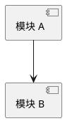
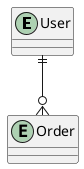
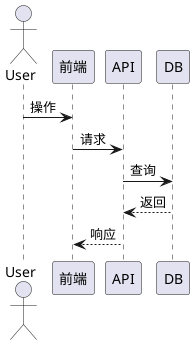
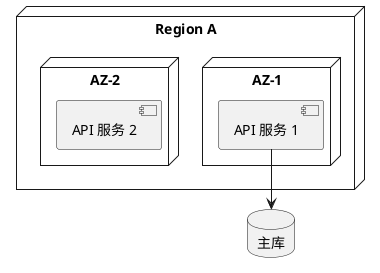

# 概要设计文档 生成大纲

## 角色定位
你是一名首席设计师，基于需求文档与架构文档，生成系统概要设计文档，明确模块划分、接口契约、数据模型与核心流程。

## 目标读者
- 开发工程师：关注模块划分、接口契约、数据模型
- 测试工程师：关注接口规范、错误码、测试策略
- 架构师：关注设计目标、关键决策、整体架构

## 章节结构

### 第1章 引言
**目的**：阐明编写目的、项目背景、系统范围与参考文档。
**要点**：
- 编写目的（面向读者、与详细设计的边界）
- 项目背景（业务背景、市场窗口、触发本设计的因素）
- 系统范围（In-Scope / Out-of-Scope）
- 术语与缩略语
- 参考文档（PRD、技术架构文档等）
- 版本历史

### 第2章 系统总体设计
**目的**：定义设计目标、总体架构与技术栈。
**要点**：
- 设计目标（3-5 条核心目标：业务、性能、可用性、可扩展性）
- 总体架构图（系统级，展示主要分层与外部依赖）
- 技术栈（前端/后端/数据库/中间件，含选型/版本/理由）
- 设计模式与约定（分层、依赖注入、CQRS、Repository、命名约定、编码规范）
- 关键设计决策（决策/选项/选择/理由）
**示例/模板**：
```plantuml
@startuml
!include https://raw.githubusercontent.com/plantuml-stdlib/C4-PlantUML/master/C4_Context.puml
Person(user, "<用户>")
System(sys, "<系统名>", "<职责>")
System_Ext(ext, "<外部系统>", "<协议>")
Rel(user, sys, "<动作>")
Rel(sys, ext, "<动作>", "<协议>")
@enduml
```

### 第3章 模块划分
**目的**：拆分模块、绘制依赖图、定义模块职责与通信。
**要点**：
- 模块清单（模块/职责 SRP/团队/关键依赖）
- 模块依赖图（PlantUML，禁止环依赖）
- 模块职责详述（输入/处理/输出）
- 模块间通信（调用方/被调用方/协议/同步异步）
**示例/模板**：


### 第4章 接口设计
**目的**：定义接口分类、规范、清单与契约。
**要点**：
- 接口分类（内部接口/外部接口/系统接口）
- 接口规范（协议 REST/GraphQL/gRPC、版本策略、数据格式、鉴权、错误模型）
- 接口清单（接口/方法/路径/入参/出参/鉴权）
- 接口契约示例（OpenAPI/Protobuf，本章仅放索引与示例）
- 错误码体系（错误码/含义/HTTP 状态/处理建议）
**示例/模板**：
```yaml
openapi: 3.0.0
paths:
  /v1/orders:
    post:
      summary: 创建订单
```

### 第5章 数据模型
**目的**：定义概念模型、逻辑模型、数据字典与存储选型。
**要点**：
- 概念模型（ER 概念图，核心实体与关系）
- 逻辑模型（含主外键的 ER 图）
- 数据字典（表名/字段/类型/必填/默认/说明）
- 存储选型（数据类型/选型/理由/数据量级）
- 数据流转（入口到出口流转链路）
**示例/模板**：


### 第6章 核心流程
**目的**：用图表化描述用例、时序、状态与活动。
**要点**：
- 用例清单（用例/主参与者/业务价值）
- 时序图（核心场景，每个核心用例一张）
- 状态图（核心对象状态流转）
- 活动图（复杂业务流程）
**示例/模板**：


### 第7章 异常处理与日志规范
**目的**：定义异常分级、处理策略、错误码体系与日志规范。
**要点**：
- 异常分级（P0/P1/P2 定义、处理方式、通知方式）
- 异常处理策略（重试、熔断、降级、限流）
- 错误码体系（按模块分段，如 40000-40999 用户模块）
- 日志规范（结构化 JSON、必含字段 timestamp/level/traceId/spanId/userId/module/message、级别、保留期）
- 告警规则（触发条件/级别/路由）

### 第8章 性能设计
**目的**：定义性能指标、容量规划与优化策略。
**要点**：
- 性能指标（接口 P50/P95/P99/吞吐/并发）
- 容量规划（当前基线/增长预测/扩容路径）
- 性能优化策略（多级缓存、消息队列、批处理、索引）
- 瓶颈分析（瓶颈/位置/影响/优化方案）
- 压测方案（工具 k6/JMeter/Locust、场景、通过标准）

### 第9章 部署设计
**目的**：定义部署架构、环境策略、流水线与配置管理。
**要点**：
- 部署架构（拓扑图与说明）
- 环境策略（Dev/Test/Staging/Prod 用途/数据/配置）
- 部署流水线（构建/测试/发布蓝绿金丝雀/回滚）
- 配置管理（配置中心、密钥管理、灰度开关）
- 运维与监控（监控指标、日志采集、告警规则与值班）
**示例/模板**：


### 第10章 安全设计
**目的**：定义安全模型、IAM、数据安全与威胁建模。
**要点**：
- 安全模型（零信任/边界防护/多层防御）
- 身份与鉴权（OAuth2/OIDC/JWT、RBAC/ABAC、会话超时/续期）
- 数据安全（静态加密 AES-256、传输加密 TLS 1.3、字段脱敏、密钥管理 KMS/Vault）
- 威胁建模（STRIDE 矩阵）
- 合规要求（个保法、GDPR 等法规适用范围与关键义务）
- 审计日志（关键操作、留存期、不可篡改方案）

### 第11章 用户界面设计（如适用）
**目的**：定义信息架构、关键页面与交互流程。
**要点**：
- 信息架构（页面层级与导航结构）
- 关键页面（页面/用途/关键组件）
- 交互流程（核心交互的用户旅程图）
- 设计规范（设计系统如 Ant Design、主题颜色字体间距、响应式断点）
- 若系统无前端可整章标注"不适用"

### 第12章 测试策略
**目的**：定义测试分层、可测试性设计与测试数据。
**要点**：
- 测试分层（单元/集成/端到端/性能测试，范围/工具/覆盖率目标）
- 可测试性设计（依赖注入、Mock 方案、测试数据生成策略）
- 测试数据（Faker/工厂模式、数据隔离、敏感数据脱敏）
- 测试环境（CI 集成、测试报告位置）

### 第13章 附录
**目的**：提供术语表、图表索引、参考资料与变更历史。
**要点**：
- 术语表完整版（与 §1.4 同步）
- 图表索引（章节/图表/文件）
- 参考资料（《设计模式》GoF、《领域驱动设计》Eric Evans、《重构》Martin Fowler、C4 Model、arc42 Template）
- 变更历史
- 评审记录

## 写作规范
- 模块依赖图必须无环
- 接口契约优先用 OpenAPI/Protobuf 描述
- 数据模型 ER 图优先用 PlantUML
- 时序图覆盖每个核心用例
- 错误码按模块分段，编号不可重复
- 设计决策必须有理由，并与 ADR 关联

## 输出格式
- 默认语言：简体中文
- 默认格式：Markdown
- 章节编号：1, 1.1, 1.1.1
- 图表：必要处插入 PlantUML 图（C4/时序图/ER 图）
- 表格：使用 Markdown 表格
- 转 Word：`pandoc 本文件 -o 输出.docx --toc --toc-depth=3`
